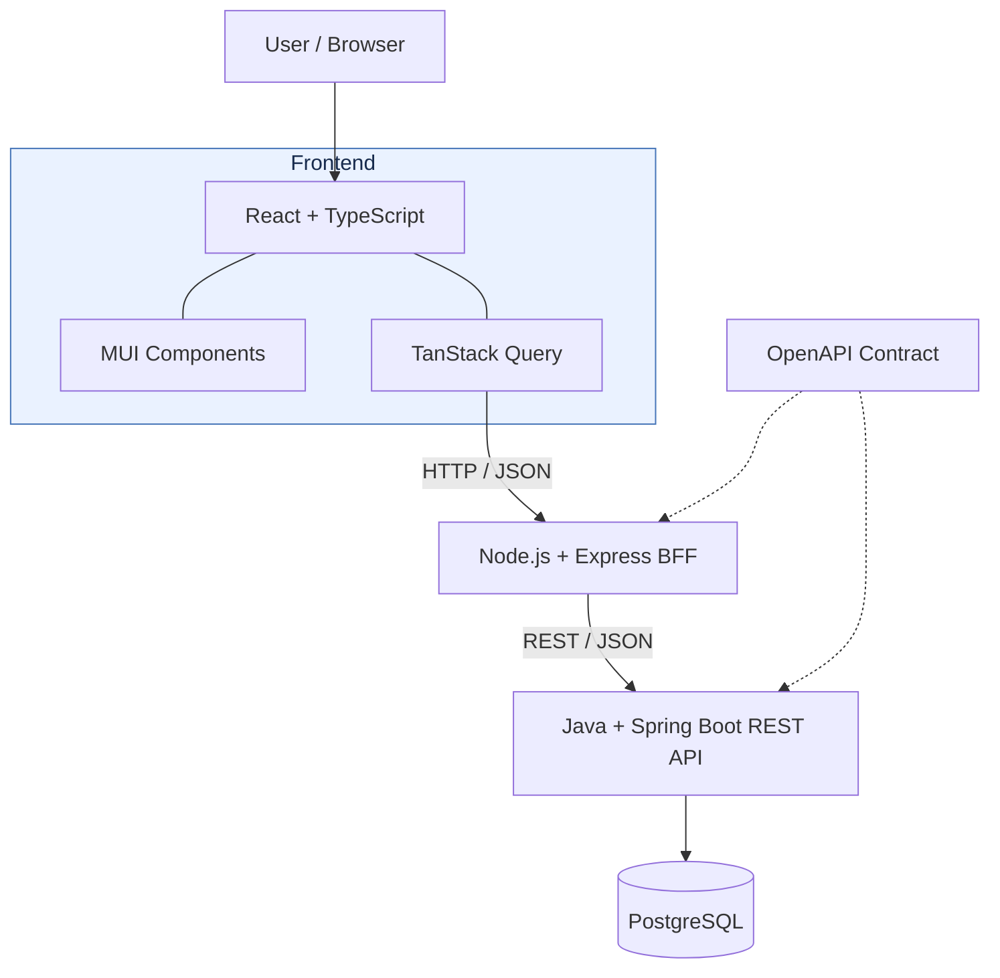

# Architecture and Repository Layout

This guide describes the intended architecture and distinguishes it from what is currently present. At this stage, the repository contains the README, project specifications, project skills under `.github/skills/`, and repository ignore rules; application modules, API contracts, database assets, tests, CI workflows, and local infrastructure have not yet been implemented. This document and the development guide are the initial files under `docs/`.

## Repository layout

| Location | Purpose | Status |
| --- | --- | --- |
| `frontend/` | React and TypeScript single-page application, MUI presentation, feature-oriented UI, and TanStack Query server-state handling | Planned |
| `bff/` | Node.js and Express frontend-facing API, request orchestration, backend client, and downstream error mapping | Planned |
| `backend/` | Java and Spring Boot versioned REST API, validation, application/domain rules, and persistence access | Planned |
| `contracts/` | OpenAPI contract and examples, if selected as a maintained contract location | Planned; source-of-truth workflow is undecided |
| `database/` | Flyway migrations and reproducible seed or demo data | Planned |
| Tests in `frontend/`, `bff/`, and `backend/` | Unit and component tests for their owning modules; backend and BFF integration tests belong with the relevant module | Planned with the modules |
| `e2e/` | Playwright tests for critical workflows across the running application | Planned |
| `docs/architecture.md` | This guide to module purpose, boundaries, and request flow | Present |
| `docs/development.md` | Contributor workflow and verification conventions | Present |
| `docs/adr/` | Architecture Decision Records for decisions that warrant a durable rationale | Planned |
| `.github/workflows/` | GitHub Actions build, test, and quality-check workflows | Planned |
| `infra/` | Dockerfiles and supporting infrastructure configuration, if needed | Planned |
| `compose.yaml` | Local full-stack Docker Compose environment | Planned |
| `.env.example` | Example environment-variable names and non-secret defaults | Planned |
| `.github/skills/` | Repository-specific Copilot skills | Present |
| `specs/` | Mission, technology choices, roadmap, and feature specifications | Present |
| `README.md`, `.gitignore` | Project overview and Git ignore rules | Present |

There is no central `tests/` directory defined. Keep tests with the module or scope they verify unless a later project decision establishes another convention. A planned directory or capability in this table is not evidence that it exists or is runnable.

## System architecture

The diagram shows the intended request path and API contract relationship; it does not represent implemented or running services.



## Component responsibilities

The target request path is:

```text
Browser -> React SPA -> Express BFF -> Spring Boot REST API -> PostgreSQL
```

- **React SPA:** Owns browser presentation and interactions. MUI provides UI components, while TanStack Query manages request lifecycles, caching, mutations, and query invalidation. The browser calls the BFF; it does not call the backend directly or access the database.
- **Express BFF:** Exposes the frontend-facing HTTP API, orchestrates requests, calls the backend API, and maps downstream responses and errors for the frontend.
- **Spring Boot API:** Owns versioned REST endpoints under `/api/v1`, server-side validation, application and domain rules, and access to persistence.
- **PostgreSQL:** Stores relational application data, including games, consoles, and their relationships. Flyway is intended to manage versioned schema changes.

The BFF and backend are separate boundaries: frontend-specific request handling belongs in the BFF, while authoritative application rules and persistence access belong in the backend. Validate inputs on the client for usability and again on the server for correctness. Surface errors consistently across layers.

## Contracts, persistence, and tests

OpenAPI documents the backend API request and response shapes and supports compatibility checks between the BFF and backend. The repository has not selected whether the contract will be maintained under `contracts/`, generated from the backend, or use both approaches. Keep contract updates aligned with API changes without presuming a generation workflow.

Flyway migrations are the intended version-controlled mechanism for PostgreSQL schema changes. Database changes and seed/demo data belong with the database implementation when it is introduced; local Docker Compose is intended for development and demonstration, not production deployment.

Verification is scoped to the behavior being changed:

- Frontend unit and component tests use Jest and MSW.
- BFF unit tests use Jest; BFF integration tests cover its HTTP routes and downstream API communication.
- Backend unit and integration tests use JUnit and Spring Boot Test; persistence and migration tests exercise PostgreSQL behavior.
- OpenAPI compatibility checks cover contract changes.
- Playwright end-to-end tests exercise critical user workflows across the full application.

These tools and test scopes are the confirmed target stack, not currently implemented test suites. Exact commands and runtime versions should be documented with each module once its build configuration exists. GitHub Actions and the checks it will run are also planned.
