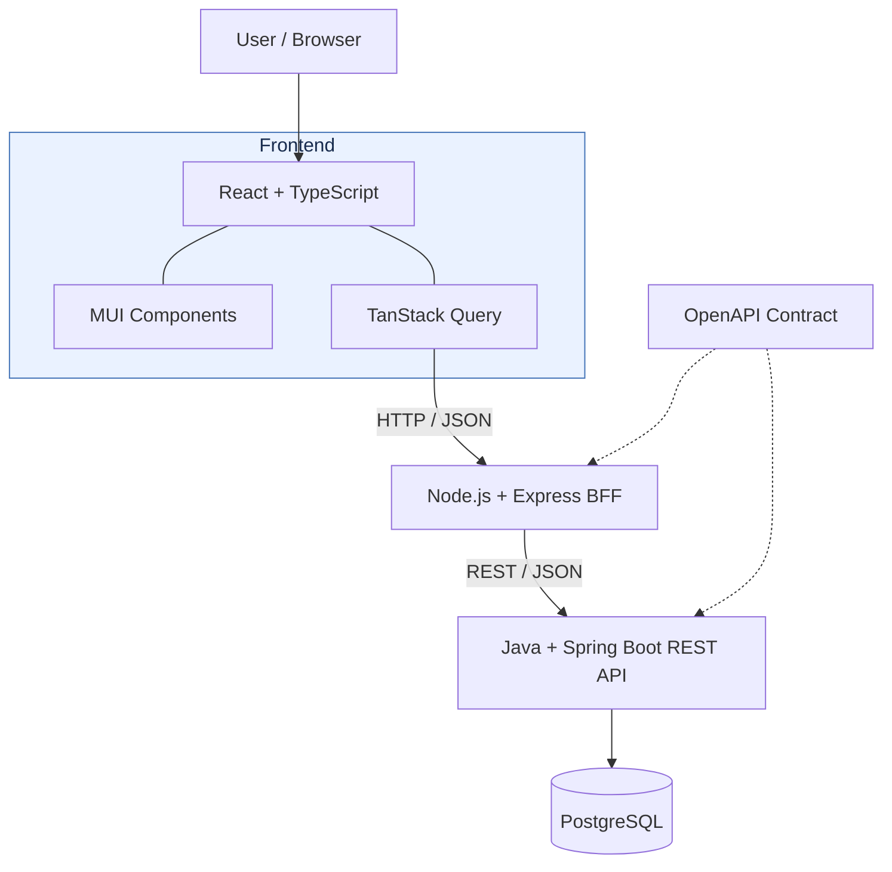

# Architecture and Repository Layout

This guide describes the implemented architecture and distinguishes it from planned work. The frontend has an accessible collection view and game details/create/edit views backed by the BFF. The BFF exposes versioned game and console routes and forwards requests to the backend. The root Compose environment can run the frontend, BFF, backend, and PostgreSQL together for local development and demonstration. The backend uses its `local` Spring profile and Flyway migrations to initialize the database, which includes a 96-console catalog and game persistence.

## Repository layout

| Location | Purpose | Status |
| --- | --- | --- |
| `frontend/` | React and TypeScript single-page application, MUI presentation, feature-oriented UI, and TanStack Query server-state handling | Responsive collection and game forms using the BFF; Docker build produces a static bundle served by Nginx with `/api` proxied to the BFF |
| `bff/` | Node.js and Express frontend-facing API, request orchestration, backend client, and downstream error mapping | Game and console route forwarding, configurable backend client, health response, and production container build |
| `backend/` | Java and Spring Boot versioned REST API, validation, application/domain rules, and persistence access | Spring Boot game/console domain, versioned CRUD/search API, Flyway schema, and persistence repositories present |
| `contracts/` | Maintained OpenAPI contract, Redocly validation package, and contract usage documentation | OpenAPI 3.1 contract for the versioned backend API and Redocly validation workflow present |
| `backend/src/main/resources/db/migration/` | Backend-owned Flyway schema migrations | Initial games, consoles, and game-console relationship migration plus 96 released-console seed entries present |
| Tests in `frontend/`, `bff/`, and `backend/` | Unit and component tests for their owning modules; backend and BFF integration tests belong with the relevant module | Frontend and BFF unit/component tests present; backend includes repository and HTTP integration tests against PostgreSQL Testcontainers, including live BFF-to-backend coverage |
| `e2e/` | Playwright tests for critical workflows across the running application | Planned |
| `docs/architecture.md` | This guide to module purpose, boundaries, and request flow | Present |
| `docs/development.md` | Contributor workflow and verification conventions | Present |
| `docs/adr/` | Architecture Decision Records for decisions that warrant a durable rationale | Planned |
| `.github/workflows/` | GitHub Actions build, test, and quality-check workflows | Planned |
| `infra/` | Dockerfiles and supporting infrastructure configuration, if needed | Planned |
| `compose.yaml` | Local Compose environment for PostgreSQL and the full application stack | PostgreSQL, backend, idempotent demo-data seed, BFF, and frontend services with health checks and readiness ordering |
| `.env.example` | Non-secret placeholders for local PostgreSQL settings | Present; copy to ignored `.env` and replace the credential placeholders |
| `.github/skills/` | Repository-specific Copilot skills | Present |
| `specs/` | Mission, technology choices, roadmap, and feature specifications | Present |
| `README.md`, `.gitignore` | Project overview and Git ignore rules | Present |

There is no central `tests/` directory defined. Keep tests with the module or scope they verify unless a later project decision establishes another convention. A planned directory or capability in this table is not evidence that it exists or is runnable.

## System architecture

The diagram shows the intended request path and API contract relationship. The frontend collection view currently uses a local fixture-backed data source for collection search and game data and does not yet call the BFF. The BFF can forward requests to the independently runnable backend. PostgreSQL can be started separately for local development; the backend connects to it only when the `local` Spring profile is enabled.



## Component responsibilities

The target request path is:

```text
Browser -> React SPA -> Express BFF -> Spring Boot REST API -> PostgreSQL
```

- **React SPA:** Owns browser presentation and interactions. MUI provides UI components, while TanStack Query manages request lifecycles, caching, mutations, and query invalidation. The browser calls the BFF; it does not call the backend directly or access the database.
- **Express BFF:** Exposes the frontend-facing HTTP API, orchestrates requests, calls the backend API, and maps downstream responses and errors for the frontend.
- **Spring Boot API:** Owns versioned REST endpoints under `/api/v1`, server-side validation, application and domain rules, and access to persistence.
- **PostgreSQL:** Stores relational application data, including games, consoles, and their relationships. Flyway manages versioned schema changes.

The BFF and backend are separate boundaries: frontend-specific request handling belongs in the BFF, while authoritative application rules and persistence access belong in the backend. Validate inputs on the client for usability and again on the server for correctness. Surface errors consistently across layers.

## Contracts, persistence, and tests

OpenAPI documents the backend API request and response shapes and supports compatibility checks between the BFF and backend. The maintained OpenAPI 3.1 source of truth is `contracts/openapi.yaml`; validate changes with the documented command in `contracts/README.md`. The contract is maintained separately from the backend implementation. Keep contract updates aligned with API changes.

Flyway migrations under `backend/src/main/resources/db/migration/` version the backend-owned PostgreSQL schema. The initial migration creates games, consoles, and game-console associations; the next seeds released console platforms from generations 2 through 9. The adapted name list is attributed in the seed migration to Wikipedia contributors under [CC BY-SA 4.0](https://creativecommons.org/licenses/by-sa/4.0/). Local Docker Compose is intended for development and demonstration, not production deployment.

## Local database setup

The root `compose.yaml` defines PostgreSQL 17.6 Alpine with a persistent named volume and the frontend, BFF, backend, and demo-data seeder. Its `POSTGRES_DB`, `POSTGRES_USER`, and `POSTGRES_PASSWORD` settings are required and supplied from the ignored root `.env` file; `.env.example` contains placeholders only. `POSTGRES_PORT` sets the host-side PostgreSQL port (default `5432`); the backend uses the Compose service name `postgres` and its internal port. The backend's `application-local.properties` maps its datasource settings when the `local` profile is active. The default backend profile excludes datasource auto-configuration, preserving standalone startup without PostgreSQL.

When the backend starts with the `local` profile, Flyway applies its schema migrations and seeds the supported console catalog. After the backend is healthy, the Compose `demo-data` service applies the separate idempotent `database/demo-games.sql` seed. Nginx serves the built frontend and proxies browser `/api` requests to the BFF; the BFF uses the Compose service name `backend`, and the backend uses `postgres`. `docker compose down` stops the stack while preserving local data in its volume; `docker compose down --volumes` removes that volume and permanently deletes the data. The Compose services are for local development and demonstration, not production deployment.

Verification is scoped to the behavior being changed:

- Frontend unit and component tests use Jest and MSW.
- BFF unit tests use Jest; BFF integration tests cover its HTTP routes and downstream API communication.
- Backend unit tests use JUnit; PostgreSQL migration and persistence tests use Spring Boot Test and Testcontainers.
- OpenAPI compatibility checks cover contract changes.
- Playwright end-to-end tests exercise critical user workflows across the full application.

These tools and test scopes are the confirmed target stack. The backend's PostgreSQL integration tests require Docker. GitHub Actions and the checks it will run are planned.
