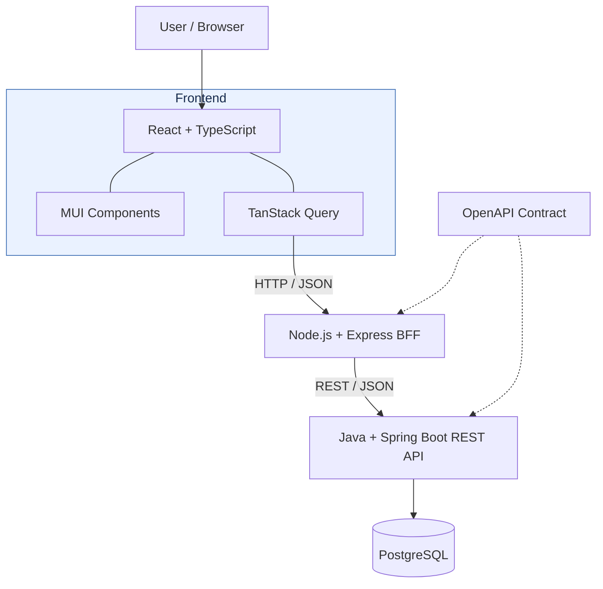

# Architecture and Repository Layout

This guide describes the intended architecture and distinguishes it from what is currently present. The frontend, BFF, and backend contain independently runnable starter scaffolds. A database-only local PostgreSQL Compose service is available, and the backend can opt into its datasource with the `local` Spring profile. The backend now has an initial Flyway schema, a 96-console catalog seed, and game persistence repositories; the collection API/UI, BFF integration, CI workflows, and full-stack local environment remain planned.

## Repository layout

| Location | Purpose | Status |
| --- | --- | --- |
| `frontend/` | React and TypeScript single-page application, MUI presentation, feature-oriented UI, and TanStack Query server-state handling | Minimal Vite/React scaffold present; collection UI planned |
| `bff/` | Node.js and Express frontend-facing API, request orchestration, backend client, and downstream error mapping | Minimal Express health response present; API and backend client planned |
| `backend/` | Java and Spring Boot versioned REST API, validation, application/domain rules, and persistence access | Spring Boot scaffold, game/console domain, initial Flyway schema, and persistence repositories present; API planned |
| `contracts/` | Maintained OpenAPI contract, Redocly validation package, and contract usage documentation | OpenAPI 3.1 contract for planned backend API present; endpoint implementation remains planned |
| `backend/src/main/resources/db/migration/` | Backend-owned Flyway schema migrations | Initial games, consoles, and game-console relationship migration plus 96 released-console seed entries present |
| Tests in `frontend/`, `bff/`, and `backend/` | Unit and component tests for their owning modules; backend and BFF integration tests belong with the relevant module | Backend domain unit and PostgreSQL persistence/migration integration tests present; frontend and BFF suites planned |
| `e2e/` | Playwright tests for critical workflows across the running application | Planned |
| `docs/architecture.md` | This guide to module purpose, boundaries, and request flow | Present |
| `docs/development.md` | Contributor workflow and verification conventions | Present |
| `docs/adr/` | Architecture Decision Records for decisions that warrant a durable rationale | Planned |
| `.github/workflows/` | GitHub Actions build, test, and quality-check workflows | Planned |
| `infra/` | Dockerfiles and supporting infrastructure configuration, if needed | Planned |
| `compose.yaml` | Local PostgreSQL-only Compose service; later extended for the full-stack environment | Database-only service present; full-stack environment planned for Phase 4.2 |
| `.env.example` | Non-secret placeholders for local PostgreSQL settings | Present; copy to ignored `.env` and replace the credential placeholders |
| `.github/skills/` | Repository-specific Copilot skills | Present |
| `specs/` | Mission, technology choices, roadmap, and feature specifications | Present |
| `README.md`, `.gitignore` | Project overview and Git ignore rules | Present |

There is no central `tests/` directory defined. Keep tests with the module or scope they verify unless a later project decision establishes another convention. A planned directory or capability in this table is not evidence that it exists or is runnable.

## System architecture

The diagram shows the intended request path and API contract relationship. The current application scaffolds start independently and do not yet communicate with each other. PostgreSQL can be started separately for local development; the backend connects to it only when the `local` Spring profile is enabled.



## Component responsibilities

The target request path is:

```text
Browser -> React SPA -> Express BFF -> Spring Boot REST API -> PostgreSQL
```

- **React SPA:** Owns browser presentation and interactions. MUI provides UI components, while TanStack Query manages request lifecycles, caching, mutations, and query invalidation. The browser calls the BFF; it does not call the backend directly or access the database.
- **Express BFF:** Exposes the frontend-facing HTTP API, orchestrates requests, calls the backend API, and maps downstream responses and errors for the frontend.
- **Spring Boot API:** Owns versioned REST endpoints under `/api/v1`, server-side validation, application and domain rules, and access to persistence.
- **PostgreSQL:** Stores relational application data, including games, consoles, and their relationships. Flyway manages versioned schema changes.

The BFF and backend are separate boundaries: frontend-specific request handling belongs in the BFF, while authoritative application rules and persistence access belong in the backend. Validate inputs on the client for usability and again on the server for correctness. Surface errors consistently across layers.

## Contracts, persistence, and tests

OpenAPI documents the backend API request and response shapes and supports compatibility checks between the BFF and backend. The maintained OpenAPI 3.1 source of truth is `contracts/openapi.yaml`; validate changes with the documented command in `contracts/README.md`. The contract is not generated from the backend, and it documents planned behavior rather than implemented endpoints. Keep contract updates aligned with API changes.

Flyway migrations under `backend/src/main/resources/db/migration/` version the backend-owned PostgreSQL schema. The initial migration creates games, consoles, and game-console associations; the next seeds released console platforms from generations 2 through 9. The adapted name list is attributed in the seed migration to Wikipedia contributors under [CC BY-SA 4.0](https://creativecommons.org/licenses/by-sa/4.0/). Local Docker Compose is intended for development and demonstration, not production deployment.

## Local database setup

The root `compose.yaml` currently defines only a PostgreSQL 17.6 Alpine container, exposed on host port `5432`, with a persistent named volume. Its `POSTGRES_DB`, `POSTGRES_USER`, and `POSTGRES_PASSWORD` settings are required and supplied from the ignored root `.env` file; `.env.example` contains placeholders only. `POSTGRES_HOST` and `POSTGRES_PORT` document the host-side connection (`localhost:5432`). The backend's `application-local.properties` maps these settings into its datasource when the `local` profile is active. The default backend profile excludes datasource auto-configuration, preserving standalone startup without PostgreSQL.

When the backend starts with the `local` profile, Flyway applies its schema migrations and seeds the supported console catalog in the configured database. `docker compose down` stops the service while preserving local data in its volume; `docker compose down --volumes` removes that volume and permanently deletes the data. This database-only service is separate from the planned Phase 4.2 Compose environment, which will add the frontend, BFF, backend, and sample data.

Verification is scoped to the behavior being changed:

- Frontend unit and component tests use Jest and MSW.
- BFF unit tests use Jest; BFF integration tests cover its HTTP routes and downstream API communication.
- Backend unit tests use JUnit; PostgreSQL migration and persistence tests use Spring Boot Test and Testcontainers.
- OpenAPI compatibility checks cover contract changes.
- Playwright end-to-end tests exercise critical user workflows across the full application.

These tools and test scopes are the confirmed target stack. The backend's PostgreSQL integration tests require Docker. GitHub Actions and the checks it will run are planned.
